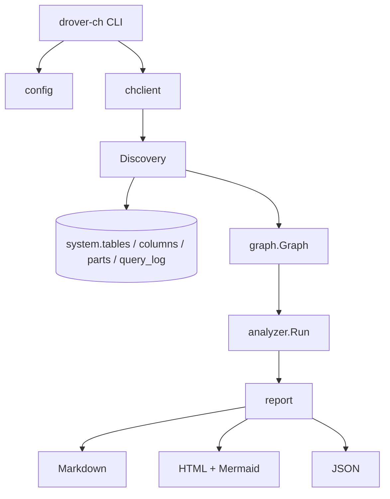

# drover-ch-optimiser — Design Document

**Version:** 1.0  
**Status:** Implementation (starter)  
**Family:** [Drover](https://github.com/cloud-shuttle) (cloud-shuttle)  
**Repository:** `drover-ch-optimiser`

---

## 1. Executive Summary

**drover-ch-optimiser** is a single static Go binary that audits a ClickHouse warehouse against the official [ClickHouse Best Practices](https://clickhouse.com/docs/best-practices) (31 rules across schema, query, insert, and agent categories). It surfaces prioritized, actionable optimizations and visualizes the warehouse as a dependency + query-usage graph.

**One command** → health scorecard, issue list, suggested fixes, and an interactive Mermaid/HTML graph.

| Property | Choice |
|----------|--------|
| Runtime | Zero external deps (static binary) |
| Protocol | Native + HTTP via `clickhouse-go/v2` |
| Safety | Read-only by default |
| Outputs | Markdown, HTML, JSON |
| Integration | Drover agents, CI cron, consulting deliverables |

### Core value

- Codifies battle-tested rules (PK order, types, partitioning, mutations, skipping indexes).
- Cross-references **DDL** with **query_log** filter patterns.
- Shows **MV chains**, distributed tables, and hot query paths in one graph.
- Agent-ready structured JSON for `drover-code` and future MCP exposure.

### Target users

- Self-hosted and ClickHouse Cloud teams  
- Consultants and SREs running audits  
- Drover users with ClickHouse observability backends  
- AI agents reasoning about data infrastructure  

---

## 2. Goals and non-goals

### Goals (v1)

1. Executable best-practices rule engine aligned with official rule IDs (`schema-pk-cardinality-order`, etc.).
2. High-impact issue detection with severity (Critical / High / Medium / Low).
3. Full warehouse dependency graph + query-weighted edges.
4. Professional Markdown and self-contained HTML reports.
5. Drover-family CLI conventions (`~/.drover/ch-optimiser.yaml`, JSON output).

### Non-goals (v1)

- Auto-applying `ALTER TABLE` in production (suggest-only / dry-run).
- Real-time monitoring (use OTel + Grafana in Drover stack).
- Every exotic engine (focus: MergeTree family, MVs, Distributed, Dictionary).
- Perfect SQL parsing (heuristics + sampling are sufficient for low-hanging fruit).

---

## 3. Architecture



### Layers

| Package | Responsibility |
|---------|----------------|
| `cmd/drover-ch` | Cobra CLI: `audit`, `graph`, `rules`, `suggest` |
| `internal/config` | Profiles, env overrides, defaults |
| `internal/chclient` | Connection, query helpers, timeouts |
| `internal/graph` | Nodes, edges, builder, Mermaid/DOT |
| `internal/analyzer` | YAML rules + Go evaluators, scoring |
| `internal/report` | Templates, aggregation, file writers |

Design principles: **layered**, **testable**, **pluggable rules** (YAML + native Go for complex checks).

---

## 4. Data model

### Nodes (`graph.Table`)

- Identity: `database.name`
- Metadata from `system.tables`: engine, DDL, partition/sort keys, dependencies
- Physical stats: rows, bytes, active parts (from `system.parts`)
- Optimizer: `HealthScore`, `Issues[]`, `HotQueries`, `LastUsed`
- Render: `NodeType`, color by worst severity

### Edges (`graph.Edge`)

| Type | Meaning |
|------|---------|
| `depends_on` | Source table → MV (reads from) |
| `populates` | MV → target table |
| `query_uses` | Query pattern → table (weighted by freq × duration) |
| `distributed` | Distributed → local |
| `dict_lookup` | Query → dictionary |

### Graph operations (v1.1+)

- BFS/DFS upstream/downstream for impact analysis
- Subgraph by `--focus db.table`
- Cluster by database or health tier

---

## 5. Discovery and SQL

### Tables

```sql
SELECT
    database, name, engine, engine_full, create_table_query,
    partition_key, sorting_key, primary_key,
    dependencies_database, dependencies_table,
    total_rows, total_bytes
FROM system.tables
WHERE database NOT IN ('system', 'information_schema', 'INFORMATION_SCHEMA')
  AND is_temporary = 0
```

### Columns (for type / Nullable / LowCardinality rules)

```sql
SELECT database, table, name, type, default_kind, comment
FROM system.columns
WHERE database NOT IN ('system', 'information_schema', 'INFORMATION_SCHEMA')
```

### Parts health

```sql
SELECT database, table, count() AS active_parts, sum(rows) AS rows
FROM system.parts
WHERE active AND database NOT IN ('system', 'information_schema')
GROUP BY database, table
```

### Query patterns (sampled)

```sql
SELECT
    arrayJoin(tables) AS table,
    normalized_query_hash,
    count() AS freq,
    sum(query_duration_ms) AS total_duration_ms,
    max(event_time) AS last_seen
FROM system.query_log
WHERE type = 'QueryFinish'
  AND query_kind = 'Select'
  AND event_date >= today() - {days:UInt16}
  AND length(tables) > 0
GROUP BY table, normalized_query_hash
HAVING freq >= 5
ORDER BY total_duration_ms DESC
LIMIT 500
```

Graceful degradation if `query_log` is disabled or empty.

---

## 6. Rules engine

Rules are defined in `internal/analyzer/rules.yaml` with IDs matching official skill rule filenames where possible.

### Evaluation flow

1. Load embedded YAML at startup (`//go:embed`).
2. For each table node, run condition handlers in parallel (`sync.WaitGroup`).
3. Emit `OptimizationIssue` with rule ID, severity, message, suggestion.
4. Compute warehouse `HealthScore` (100 − weighted penalties).

### Condition types (v1)

| Type | Rule alignment |
|------|----------------|
| `sorting_key_cardinality` | `schema-pk-cardinality-order` |
| `missing_filter_in_pk` | `schema-pk-prioritize-filters` |
| `string_abuse` | `schema-types-native-types` |
| `missing_lowcardinality` | `schema-types-lowcardinality` |
| `excessive_nullable` | `schema-types-avoid-nullable` |
| `partition_cardinality` | `schema-partition-low-cardinality` |
| `missing_skipping_index` | `query-index-skipping-indices` |
| `mutation_heavy` | `insert-mutation-avoid-update` |
| `too_many_parts` | parts / merge health |

Complex rules can register native Go functions alongside YAML.

### Scoring

- Critical: −15 each (cap logic in summary)
- High: −7 each  
- Per-table score: 100 − local penalties  
- Node color: red (critical), orange (high), yellow (medium), green (healthy)

---

## 7. Graph visualization

### Outputs

| Format | Use case |
|--------|----------|
| Mermaid `flowchart TB` | Embedded in Markdown/HTML |
| Self-contained HTML | Tailwind + Mermaid CDN, email/share |
| JSON | Agents, Cytoscape/React Flow later |
| DOT (future) | PNG/SVG via Graphviz |

### Node shapes (Mermaid)

- Table: `["label"]`
- Materialized view: `{{"label"}}`
- View: `("label")`
- Dictionary: `[["label"]]`

### Integration with optimizer

- Node stroke color = worst issue severity  
- Edge thickness ∝ `query_uses` weight  
- `--focus` highlights upstream/downstream subgraph  

**Reference:** patterns from [clickhouse-table-graph](https://github.com/mbaksheev/clickhouse-table-graph) (MV dependencies, Mermaid); extended with query_log and health scores.

---

## 8. CLI

```
drover-ch [flags] <command>

Commands:
  audit    Full audit + graph + report
  graph    Dependency graph only
  rules    List embedded rules
  suggest  Focused suggestions for one table (stub → v1.1)

Global flags:
  --config   ~/.drover/ch-optimiser.yaml
  -v         verbose

Audit / graph flags:
  -f, --format   markdown | html | json
  -o, --output   file path
  --focus        db.table subgraph
  --days         query_log window (default 30)
  --database     limit to one database
```

### Config example (`~/.drover/ch-optimiser.yaml`)

```yaml
clickhouse:
  host: localhost
  port: 9000
  database: default
  username: default
  password: ""
  secure: false
```

Environment overrides: `CLICKHOUSE_HOST`, `CLICKHOUSE_PASSWORD`, etc.

---

## 9. Reporting

### Markdown

- Executive summary (score, counts)  
- Critical / high issues by table  
- Mermaid code block  
- Table inventory  

### HTML

- Dark theme, score hero, issue cards  
- Embedded Mermaid graph  
- Sortable table overview  

### JSON schema (agent contract)

```json
{
  "generated_at": "...",
  "health_score": 72.5,
  "summary": { "critical": 3, "high": 8, "total_issues": 24 },
  "issues": [...],
  "graph": { "nodes": [...], "edges": [...] }
}
```

---

## 10. Drover ecosystem integration

| Integration | Plan |
|-------------|------|
| Repo | `github.com/cloud-shuttle/drover-ch-optimiser` |
| Binary name | `drover-ch` |
| Agent command | `.drover/commands/clickhouse-audit.md` |
| `drover-code` | Shell tool / JSON parse of `audit -f json` |
| Telemetry | Optional: emit run metadata to team ClickHouse |
| MCP (future) | `audit` as MCP tool for schema reasoning |

---

## 11. Security and operations

- **Read-only** role recommended (`SELECT` on `system.*`, target databases).
- Scrub passwords in logs; never print connection strings with secrets.
- `max_execution_time` and query sampling limits for large `query_log`.
- Parallel table analysis with bounded concurrency.
- Integration tests: `docker-compose` ClickHouse + golden reports.

---

## 12. Roadmap

### MVP (current starter)

- [x] CLI + config + connection  
- [x] Table/column discovery  
- [x] Top rules (schema + parts + mutations)  
- [x] Basic graph + Mermaid + HTML  
- [ ] CI + sample warehouse fixtures  

### v1.0

- Full 20+ rules from skill catalog  
- Query_log filter extraction (regex on `query` text)  
- `--focus` subgraph  
- `suggest db.table` command  
- Drover command markdown  

### v1.1+

- What-if PK change impact  
- `ALTER` dry-run suggestions  
- TUI (Bubble Tea)  
- DOT export, interactive filters in HTML  
- Cluster / `clusterAllReplicas` mode  

---

## 13. Success metrics

| Metric | Target |
|--------|--------|
| Warehouse scan | &lt; 60s for 100+ tables |
| Actionable findings | ≥ 3 on typical legacy schemas |
| Graph comprehension | Non-DBA can follow MV flow |
| Adoption | Drover users + OSS community PRs |

---

## 14. References

- [ClickHouse Best Practices docs](https://clickhouse.com/docs/best-practices)  
- [clickhouse-best-practices skill](https://github.com/ClickHouse/agent-skills) (31 rules)  
- [clickhouse-table-graph](https://github.com/mbaksheev/clickhouse-table-graph)  
- [clickhouse-go/v2](https://github.com/ClickHouse/clickhouse-go)  

---

*This document is the source of truth for architecture and scope. Implementation details live in `internal/` packages and `rules.yaml`.*
